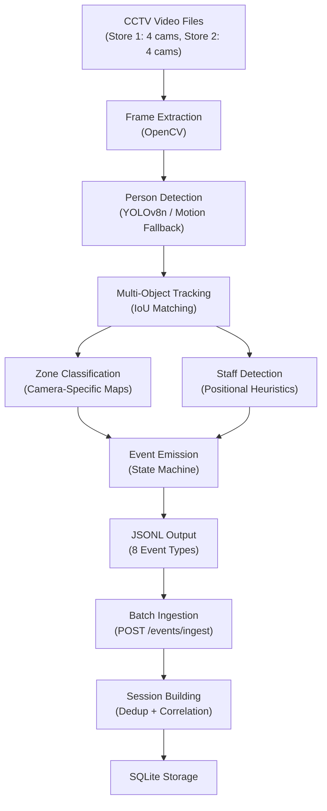
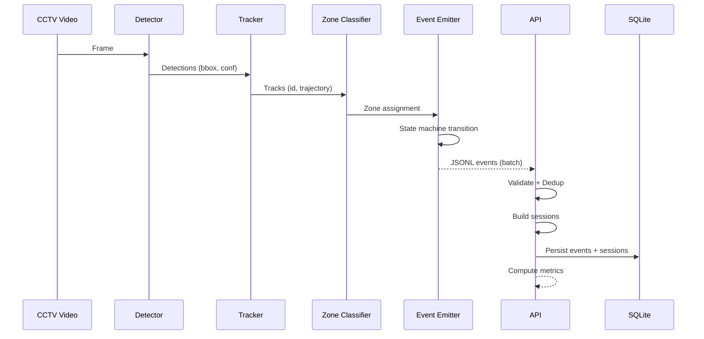

# Store Intelligence — Design Document (PS3f Aligned)

## Architecture Overview

The system follows a **four-layer architecture** designed for clarity, testability, and production reliability:

```
Raw CCTV Clips (5 stores × 3 cameras) → Detection + Tracking → Structured Events → Intelligence API → Metrics / Dashboard
                                                     ↓
                                            Persistent SQLite Store
                                                     ↑
                                               POS CSV Data + Store Layout
```

### Layer 1: Detection + Tracking Pipeline (`pipeline/`)
- **Person Detection**: YOLOv8n for COCO person class detection with motion-based fallback
- **Multi-Object Tracking**: IoU-based tracker with persistent track IDs and trajectory history
- **Zone Classification**: Multi-store camera-specific geometric zone maps with dynamic layout loading
- **Staff Detection**: Positional heuristics (stationary presence near billing counters)
- **Event Emission**: State-machine based, emitting 8 structured event types to JSONL
- **Multi-Store Support**: Independent processing per store with store-specific camera maps

### Layer 2: Event Stream (`data/events.jsonl`)
- Schema-validated JSONL output
- Supports both internal format AND PS3f native format (entry/exit, zone, queue events)
- Globally unique `event_id` per event
- Ordered by timestamp
- Deduplication at ingestion time via idempotency table

### Layer 3: Intelligence API (`app/`)
- FastAPI application with 8 core endpoints
- Session-based business logic (not raw event counting)
- POS correlation with 5-minute billing-zone window rule
- Anomaly detection with six alert types (including GROUP_SURGE, FOOTFALL_ANOMALY)
- Health monitoring with per-store AND per-camera freshness tracking
- PS3f native event format auto-detection and normalization

### Layer 4: Live Dashboard (`dashboard/`)
- Streamlit web UI polling the API
- Real-time metrics, funnel visualization, zone heatmap, anomaly alerts
- Auto-refresh every 5 seconds

## Detection Pipeline Flow



## Event Processing Flow



## Event Lifecycle

1. **Detection**: YOLOv8 detects a person in a video frame
2. **Tracking**: Tracker assigns a persistent track ID to the detection
3. **Classification**: Zone classifier determines which store zone the person is in
4. **Staff Check**: Staff detector flags stationary billing-area persons
5. **State Transition**: Event emitter's state machine determines appropriate events:
   - `OUTSIDE → INSIDE` triggers `ENTRY`
   - `zone_A → zone_B` triggers `ZONE_EXIT` + `ZONE_ENTER`
   - Continuous zone presence beyond threshold triggers `ZONE_DWELL`
   - Entry into billing zone triggers `BILLING_QUEUE_JOIN`
   - Exit from billing without POS match triggers `BILLING_QUEUE_ABANDON`
   - `INSIDE → OUTSIDE` triggers `EXIT`
   - Same person returning after EXIT triggers `REENTRY`
6. **Emission**: Structured event written to JSONL with UUID, timestamp, confidence
7. **PS3f Normalization**: Auto-detect and map PS3f native formats to internal schema
8. **Ingestion**: API validates, deduplicates, and persists the event
9. **Session Building**: Events grouped into visitor sessions with demographics
10. **Metric Computation**: Sessions aggregated into business metrics

## Storage Model

SQLite with WAL mode for concurrent read/write safety.

| Table | Purpose |
|-------|---------|
| `events` | All ingested events with full schema |
| `sessions` | Visitor sessions with group/demographic data |
| `session_zone_state` | Per-zone state within sessions |
| `transactions` | POS transaction records from CSV |
| `store_daily_metrics` | Cached daily metric snapshots |
| `anomalies` | Detected anomaly records |
| `ingest_idempotency` | Event ID dedup tracking |
| `cross_camera_links` | Cross-camera visitor identity links |
| `store_layouts` | Store layout JSON storage |
| `camera_health` | Per-camera health monitoring |

## API Architecture

| Endpoint | Method | Purpose |
|----------|--------|---------|
| `/events/ingest` | POST | Batch event ingestion (internal + PS3f native format) |
| `/events/ingest/jsonl` | POST | JSONL file upload for batch ingestion |
| `/stores/{id}/metrics` | GET | Store metrics (conversion, dwell, queue, demographics) |
| `/stores/{id}/funnel` | GET | Session-based conversion funnel with POS revenue |
| `/stores/{id}/heatmap` | GET | Zone heatmap with PS3f zone metadata |
| `/stores/{id}/anomalies` | GET | Active anomaly alerts (6 types) |
| `/health` | GET | System health with per-camera status |
| `/pos/upload` | POST | POS CSV upload (PS3f + legacy format) |
| `/stores` | GET | List all stores |

## Edge Case Handling

| Edge Case | Implementation |
|-----------|---------------|
| **Group entry** | Tracked via `group_id`/`group_size` in event metadata and session |
| **Staff exclusion** | `is_staff` flag on events; staff sessions excluded from all customer metrics |
| **Visitor re-entry** | `REENTRY` event type; `is_reentry` flag on sessions |
| **Partial occlusion** | `is_face_hidden` in metadata; `has_partial_occlusion` on session; low-confidence events never suppressed |
| **Billing queue buildup** | Queue depth tracked from JOIN/ABANDON events; `wait_seconds` from PS3f queue events |
| **Empty store periods** | Zero-count responses (not errors); `FOOTFALL_ANOMALY` alert when only staff detected |
| **Cross-camera dedup** | `cross_camera_links` table; session `cross_camera_linked` flag; same `visitor_id` across cameras |

## Observability

- **Structured JSON logging** on every request with trace_id, endpoint, latency_ms, status_code
- **Health endpoint** with per-store AND per-camera freshness and stale feed warnings
- **Graceful degradation**: 503 with structured error on failure, no raw stack traces
- **Idempotent ingestion**: Double submission never inflates counts
- **Version reporting**: API version in health response

## AI-Assisted Decisions

1. **YOLOv8n selection**: AI suggested larger models; chose nano for deployment simplicity and CPU compatibility
2. **SQLite over PostgreSQL**: AI suggested PostgreSQL; chose SQLite for zero-config Docker deployment
3. **IoU tracker over DeepSORT**: AI suggested deep learning tracker; chose IoU for CPU compatibility and zero dependencies
4. **Rule-based anomalies**: AI suggested ML-based anomaly detection; chose rules for explainability and auditability
5. **State-machine events**: AI suggested event sourcing; chose simpler state machine for deterministic behavior
6. **PS3f format auto-detection**: AI suggested strict schema validation; chose auto-detection to handle all three PS3f event shapes seamlessly
7. **Multi-store zone maps**: AI suggested dynamic zone learning; chose hardcoded maps per store for reliability with dynamic JSON fallback

## Live Dashboard (Premium UI)

The system includes a premium, glassmorphic analytics dashboard built using Streamlit and Plotly. It connects to the API to display:
- Live visitor metrics, conversion rates, and queue counts.
- Dynamic conversion funnels with drop-offs and revenue correlation.
- Color-coded zone heatmaps reflecting actual customer engagement.
- Demographic profiles (age and gender distribution) inferred from CCTV metadata.
- Active system anomalies with actionable suggested actions.
- Real-time per-camera feeds and staleness indicators.


## Design Trade-offs

| Trade-off | Choice | Rationale |
|-----------|--------|-----------|
| Accuracy vs Speed | YOLOv8n (fast, adequate) | Must run on CPU from `docker compose up` |
| Complexity vs Reliability | SQLite (simple, reliable) | Zero external dependencies, survives clean clone |
| Flexibility vs Simplicity | Hardcoded zones + JSON fallback | Reliable defaults with override capability |
| Coverage vs Precision | Accept low-confidence events | Never silently suppress (PS3f §6.5) |
| Real-time vs Batch | Batch ingestion with session build | Deterministic, idempotent, reviewable |

